# ESP32-Drehbank-DRO – Positionsanzeige für bis zu 4 Achsen

[English](README.md) | **Deutsch**

Eine digitale Positionsanzeige (DRO) für die Drehbank mit einem **ESP32 DevKit V1**. Sie liest bis zu
vier Maßstäbe (Glasmaßstäbe oder Magnetband) und zeigt die Positionen auf **jedem touchfähigen
Gerät** – Handy oder Tablet – als Webseite an, die der ESP32 über sein eigenes WLAN bereitstellt.
Keine App, kein Internet, kein eigenes Display nötig.

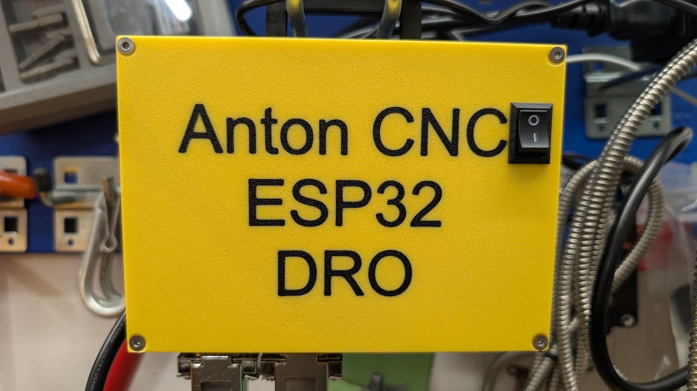

🎥 **Video:** *Link folgt, sobald das Video veröffentlicht ist*

🛠️ **Gehäusebau und Druck:** [https://www.youtube.com/watch?v=JSoUT4cyio0](https://www.youtube.com/watch?v=JSoUT4cyio0)

📺 Kanal: [Anton CNC auf YouTube](https://www.youtube.com/@boessi)

Firmware-Version: **v1.0**

---

## Inhalt

- [Funktionen](#funktionen)
- [Was liegt in diesem Repository](#was-liegt-in-diesem-repository)
- [Hardware](#hardware)
- [Verdrahtung](#verdrahtung)
- [Firmware flashen (ohne Arduino IDE)](#firmware-flashen-ohne-arduino-ide)
- [Erster Start](#erster-start)
- [Bedienung](#bedienung)
- [Funktionsweise](#funktionsweise)
- [Firmware selbst kompilieren](#firmware-selbst-kompilieren)
- [Test auf Schrittverluste](#test-auf-schrittverluste)
- [Lizenz und Haftungsausschluss](#lizenz-und-haftungsausschluss)

---

## Funktionen

- **2, 3 oder 4 Achsen** (X, Z, U, W), in den Einstellungen wählbar
- **Hardware-Zählung:** Die Pulszähler (PCNT) des ESP32 werten die A/B-Signale direkt im Chip aus,
  jede Flanke zählt (4-fach) – keine Schrittverluste durch beschäftigte Software, 0 % CPU-Last fürs Zählen
- Standard **200 Impulse/mm (5-µm-Maßstäbe)**, Vorgabe für 1 µm, eigene Werte je Achse
- **10 Werkzeuge (T1–T10)** mit eigenen Versätzen; T1 ist das Referenzwerkzeug
- **ABS / INC je Achse** – z. B. Z im Kettenmaß, während X absolut bleibt
- **Radius / Durchmesser** für den Planschlitten
- **Oberschlitten-Helfer** für Kegel und Gewinde (Winkel → ΔX / ΔZ)
- Anzeige in **mm oder Zoll**
- **SAVE** speichert Versätze, aktives Werkzeug und Maßstabsstände dauerhaft (NVS-Flash)
- **Verbindungsanzeige:** grüner/roter Punkt, Banner „CONNECTION LOST“, Warnton
- Oberfläche passt sich Handy (hochkant) und iPad an; lässt sich als App auf den Startbildschirm legen

> Die Knöpfe mit langem Drücken (SAVE, Zahnrad, 2X/3X/4X, Achsrichtung) sind für Touchscreens
> gemacht. Nimm ein Handy oder Tablet – mit der Maus geht das lange Drücken nicht.

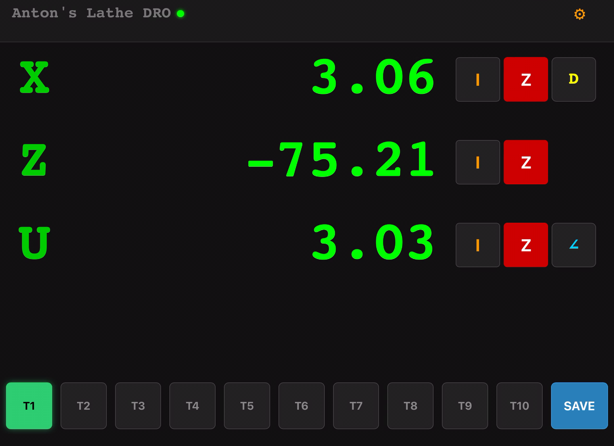

*Hauptanzeige: iPad im Querformat. Darunter dieselbe Oberfläche am Handy.*

<p align="center">
  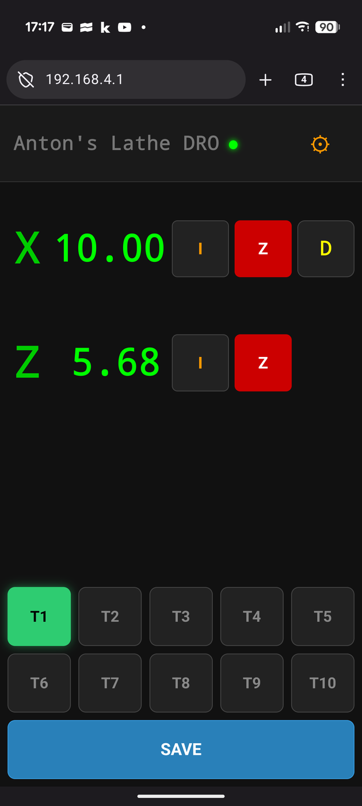
  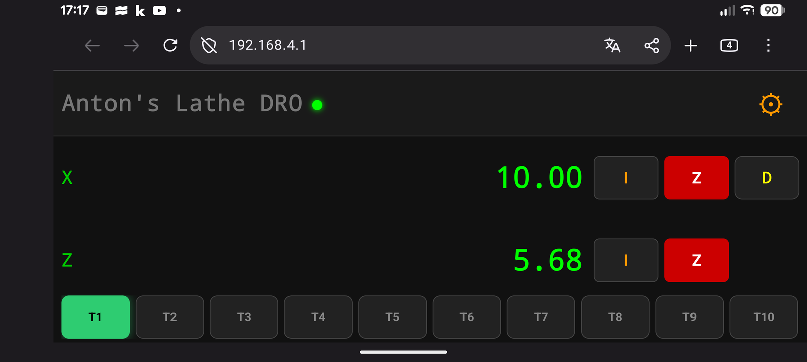
</p>


---

## Was liegt in diesem Repository

| Ordner | Inhalt |
|---|---|
| [`firmware/ESP32_Lathe_DRO/`](firmware/ESP32_Lathe_DRO/) | Arduino-Quelltext (`.ino`) |
| [`firmware/bin/`](firmware/bin/) | Fertige Dateien zum Flashen (siehe [Flashen](#firmware-flashen-ohne-arduino-ide)) |
| [`hardware/kicad/`](hardware/kicad/) | **Empfohlene Platine** – KiCad-10-Projekt und [Schaltplan als PDF](hardware/kicad/DRO_schematic.pdf) |
| [`hardware/kicad/fabrication/`](hardware/kicad/fabrication/) | Gerber, Stückliste und Bestückungsliste für JLCPCB, [Bestellhinweise](hardware/kicad/fabrication/ORDERING.md) |
| [`hardware/fusion-legacy/`](hardware/fusion-legacy/) | Erste Platinenversion aus Fusion – **ohne Pull-up-Widerstände und ohne Klemme für den Ein/Aus-Schalter**, siehe [README](hardware/fusion-legacy/README.md) |
| [`case/`](case/) | Gehäuse: Fusion-Konstruktion [`DRO_Gehaeuse.f3d`](case/DRO_Gehaeuse.f3d) (Gehäuse, Deckel, Alublech, Platinenmodell, CAM-Einrichtung) und 3D-Druckdateien (STL und 3MF) |
| [`docs/diagram/`](docs/diagram/) | Systemdiagramm (Excalidraw-Quelle und SVG) |
| [`images/`](images/) | Fotos und Ansichten |

---

## Hardware

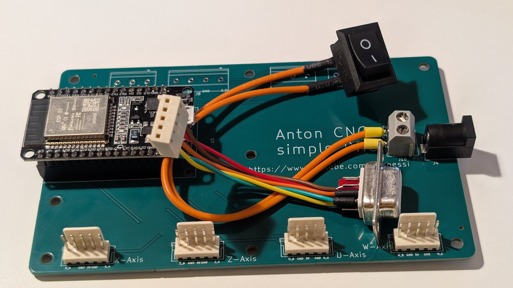

### Teile

- **Platine** aus [`hardware/kicad/`](hardware/kicad/), 130 × 80 mm, 2 Lagen. JLCPCB kann die
  SMD-Teile auf der Unterseite bestücken (U1, U2, R1–R8, C1, C2); alles andere ist bedrahtet und
  leicht von Hand zu löten. Details und Teilenummern: [ORDERING.md](hardware/kicad/fabrication/ORDERING.md).
- **ESP32 DevKit V1, 30 Pins** (ESP32-WROOM-32). Die Antenne zeigt nach außen über die Platinenkante.
- **Maßstäbe** mit 5-V-TTL-Ausgang (A/B), z. B. Glasmaßstäbe oder Magnetband-Leseköpfe, bis zu vier.
- **5-V-Netzteil** mit Hohlstecker (≥ 2 A empfohlen) und ein **Ein/Aus-Schalter** fürs Gehäuse.
- **Sub-D-9-Einbaubuchsen** für die Maßstäbe, Kabel zu den JST-XH-Buchsen auf der Platine.
- **Gehäuse:** [`case/Gehaeuse.stl`](case/Gehaeuse.stl) und [`case/Deckel.stl`](case/Deckel.stl)
  (auch als 3MF); die bearbeitbare Fusion-Konstruktion ist [`case/DRO_Gehaeuse.f3d`](case/DRO_Gehaeuse.f3d).
  Wie das Gehäuse gebaut und gedruckt wird: [Video](https://www.youtube.com/watch?v=JSoUT4cyio0).

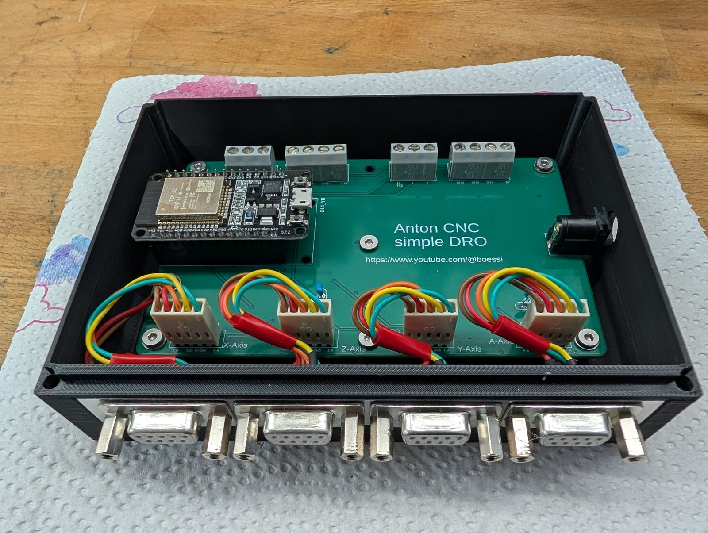

### Die Platine kurz erklärt

- **J1 / J2 / J3 / J5** (JST-XH, 5-polig): Maßstab-Eingänge X / Z / U / W
- **R1–R8** (10 kΩ nach +5 V): Pull-ups an jeder A/B-Leitung – ohne Maßstab hängt der Eingang
  sonst in der Luft, fängt Störungen ein und die Anzeige zählt Schritte, die es nicht gibt
- **U1, U2** (SN74LVC14A): Schmitt-Trigger-Inverter an 3,3 V mit 5-V-festen Eingängen – sie machen aus
  langsamen, verrauschten Flanken saubere Rechtecke und setzen 5 V auf 3,3 V für den ESP32 um. Dass
  sie das Signal umdrehen, stört nicht: Beide Spuren werden gleich behandelt.
- **J4** Hohlbuchse 5 V → **J10** Ein/Aus-Schalter → +5 V → ESP32 VIN
- **J6–J9** Schraubklemmen: freie GPIOs, +5 V, +3,3 V und GND für spätere Erweiterungen

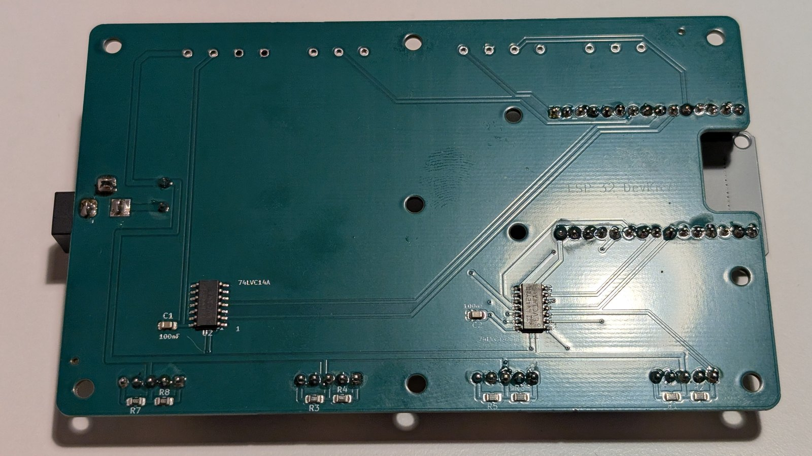

<p align="center">
  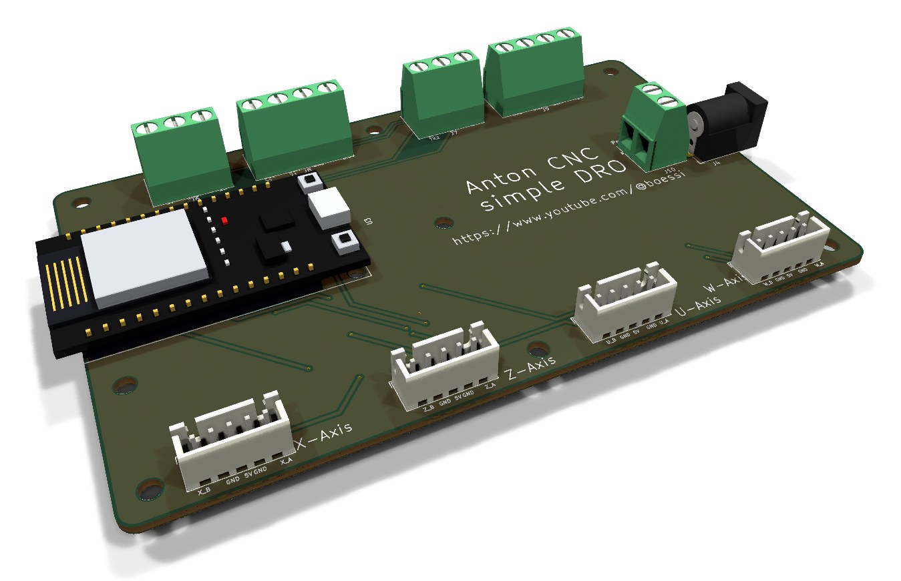
  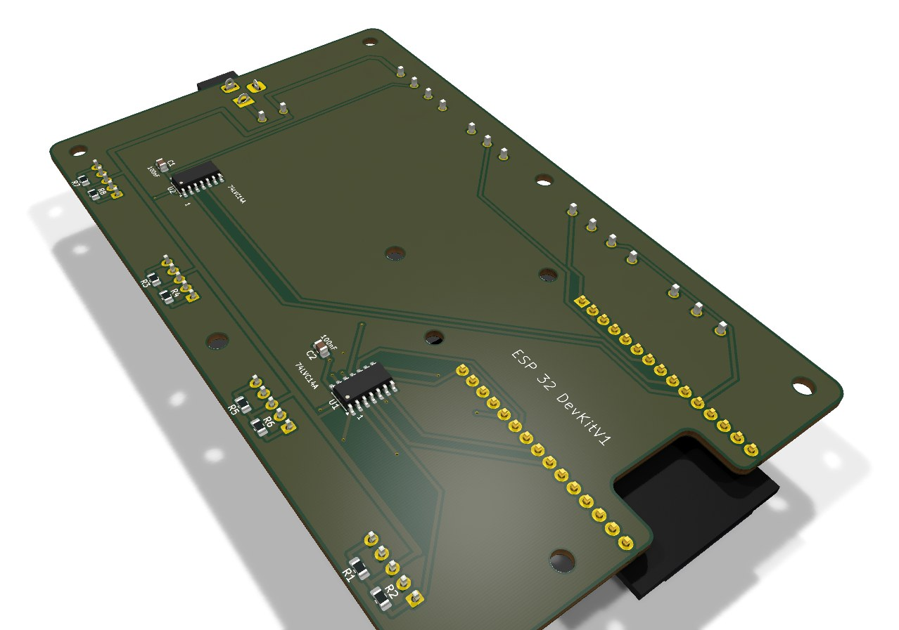
</p>

[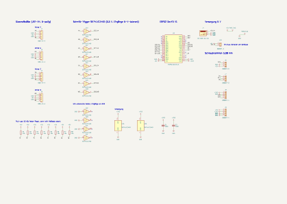](hardware/kicad/DRO_schematic.pdf)

*Schaltplan – Klick öffnet das PDF.*

---

## Verdrahtung

### Maßstab → Sub-D 9 (so im Gehäuse verdrahtet)

| Sub-D-Pin | Signal |
|---|---|
| 2 | GND |
| 4 | GND (Schirm) |
| 6 | Kanal A |
| 7 | +5 V für den Maßstab |
| 8 | Kanal B |

Die Belegung ist von Hersteller zu Hersteller verschieden – **immer das Datenblatt des Maßstabs
prüfen** und vor dem Anschließen nachmessen. A und B vertauscht dreht nur die Zählrichtung um (die
sich auch in den Einstellungen umkehren lässt).

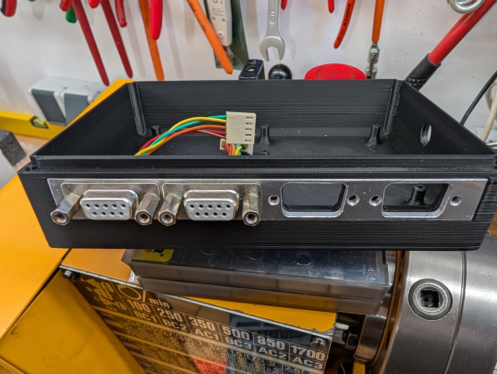

### Sub-D → JST-XH auf der Platine

| JST-Pin | 1 | 2 | 3 | 4 | 5 |
|---|---|---|---|---|---|
| Signal | B | GND | +5 V | GND | A |

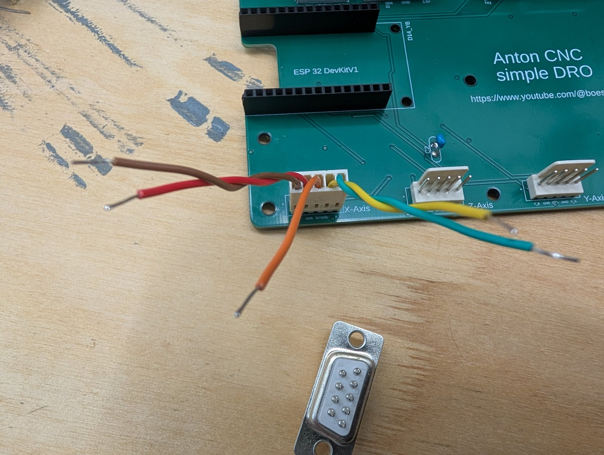

### Achsen → ESP32-Eingänge

| Achse | Buchse | Kanal A | Kanal B |
|---|---|---|---|
| X | J1 | GPIO 32 | GPIO 33 |
| Z | J2 | GPIO 25 | GPIO 26 |
| U | J3 | GPIO 27 | GPIO 14 |
| W | J5 | GPIO 19 | GPIO 18 |

### Freie Klemmen

| Klemme | Belegung |
|---|---|
| J6 | GPIO 23, GND, +5 V |
| J7 | GPIO 4, GPIO 17, GPIO 5 |
| J8 | +3,3 V, GND, GPIO 21, GPIO 22 |
| J9 | +5 V, +3,3 V, GND, GND |
| J10 | Ein/Aus-Schalter (zwischen Hohlbuchse und +5 V) |

---

## Firmware flashen (ohne Arduino IDE)

Du brauchst einen Windows-PC, ein USB-Kabel (Datenkabel, kein reines Ladekabel) und das ESP32 DevKit.

### 1. Werkzeuge herunterladen

- **Flash Download Tool** von Espressif:
  [espressif.com → Support → Download → Other Tools → „Flash Download Tools“](https://www.espressif.com/en/support/download/other-tools)
  ([Anleitung, englisch](https://docs.espressif.com/projects/esp-test-tools/en/latest/esp32/production_stage/tools/flash_download_tool.html)).
  Entpacken und `flash_download_tool_*.exe` starten – keine Installation nötig.
- **USB-Treiber**, falls Windows für das Board keinen COM-Port anzeigt. Schau auf den kleinen Chip
  neben der USB-Buchse:
  - CP2102 / CP210x → [Silicon Labs CP210x VCP-Treiber](https://www.silabs.com/developer-tools/usb-to-uart-bridge-vcp-drivers)
  - CH340 → [WCH CH341SER-Treiber](https://www.wch.cn/downloads/CH341SER_EXE.html)
- **Die Firmware:** [`firmware/bin/ESP32_Lathe_DRO_v1.0_merged.bin`](firmware/bin/ESP32_Lathe_DRO_v1.0_merged.bin)
  (auf GitHub: Datei öffnen, dann „Download raw file“).

### 2. Flashen

1. **5-V-Netzteil der DRO abziehen** und den ESP32 per USB mit dem PC verbinden.
   Im Geräte-Manager den COM-Port ablesen (z. B. COM3).
2. Flash Download Tool starten. Im ersten Fenster
   **ChipType: ESP32, WorkMode: Develop, LoadMode: UART** wählen → OK.
3. Alles wie im Bild unten einstellen:
   1. Erste Zeile im Reiter **SPIDownload**: Haken setzen, mit „…“
      `ESP32_Lathe_DRO_v1.0_merged.bin` auswählen und als Adresse **`0x0`** eintragen.
      Alle anderen Zeilen ohne Haken.
   2. **SPI SPEED: 40MHz, SPI MODE: DIO**, „DoNotChgBin“ angehakt lassen.
   3. **COM-Port** wählen, **BAUD: 921600** (falls es nicht klappt: 115200).
   4. Beim allerersten Flashen einmal **ERASE** klicken und auf „FINISH“ warten. Das löscht den
      ganzen Flash, auch früher gespeicherte Einstellungen.
   5. **START** klicken und warten, bis im Feld **„FINISH“** steht.
4. **EN** am ESP32 drücken (oder USB kurz abziehen) – der ESP32 startet neu. Fertig.

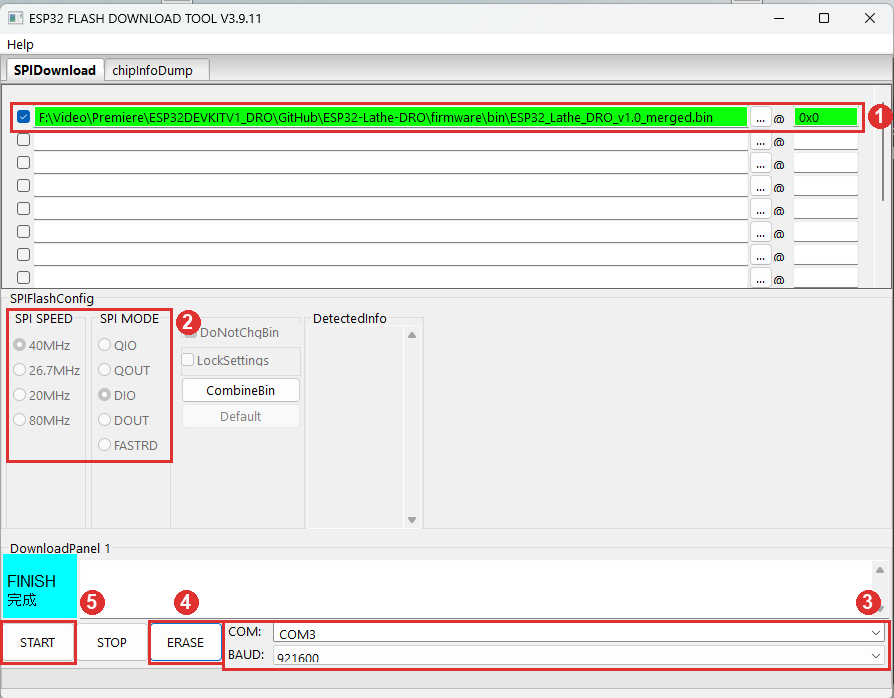

<details>
<summary>Alternative: vier Einzeldateien statt der zusammengefassten Datei</summary>

| Datei | Adresse |
|---|---|
| `bootloader.bin` | `0x1000` |
| `partitions.bin` | `0x8000` |
| `boot_app0.bin` | `0xe000` |
| `ESP32_Lathe_DRO_v1.0_app.bin` | `0x10000` |

</details>

<details>
<summary>Alternative für Linux / macOS: esptool</summary>

```
pip install esptool
esptool.py --chip esp32 --port /dev/ttyUSB0 write_flash 0x0 ESP32_Lathe_DRO_v1.0_merged.bin
```

</details>

---

## Erster Start

1. DRO einschalten, Handy oder Tablet mit dem WLAN **`AntonCNC_ESP32-DRO`** verbinden,
   Passwort **`12345678`**.
   Es ist sinnvoll, das Passwort zu ändern: Es steht im Quelltext (`password` oben in der `.ino`),
   dafür muss man die Firmware selbst kompilieren.
2. In Chrome (Android) oder Safari (iPad) **http://192.168.4.1** öffnen. Am Handy funktioniert
   Hochformat am besten.
3. Als App einrichten: Browser-Menü → **„Zum Startbildschirm hinzufügen“ / „App installieren“**.
   Danach die DRO über das neue Symbol starten – sie öffnet im Vollbild ohne Browserleisten.
4. Bildschirm wach halten: Bildschirm-Zeitlimit auf den Höchstwert stellen (oder Android-
   Entwickleroptionen → „Aktiv lassen“ beim Laden). Optional: Android „App anpinnen“ oder iPadOS
   „Geführter Zugriff“.
5. Einstellungen öffnen (**Zahnrad ⚙ 0,8 s gedrückt halten**) und Achsanzahl, Zählrichtung jeder
   Achse und Maßstabsauflösung einstellen.

---

## Bedienung

| Was | Wie |
|---|---|
| Werkzeug wählen | **T1 … T10** in der unteren Leiste antippen. T1 ist das Referenzwerkzeug: Im ABS-Modus sind alle anderen Werkzeuge relativ zu T1 gespeichert – nach einem Neustart T1 neu ankratzen. |
| Achse nullen | Rotes **Z** neben der Achse → mit **YES** bestätigen (nur für das aktive Werkzeug) |
| Wert eingeben | Oranges **I** → Ziffernfeld (mit +/-) → **SET** |
| ABS / INC | Auf den **Achsbuchstaben** tippen: grün = ABS, gelb = INC, je Achse |
| Radius / Durchmesser | **R / D** in der X-Zeile – D zeigt den Durchmesser (×2) |
| Oberschlitten-Helfer | **∠** in der U-Zeile – Winkel, U-Rohwert, daraus ΔX/ΔZ und X/Z kombiniert. Wird nicht gespeichert (nach Neuladen wieder 0). |
| Speichern | **SAVE** etwa 1 s halten bis zum Ton – speichert Versätze, aktives Werkzeug, ABS/INC-Zustand und die Maßstabsstände |
| Einstellungen | **⚙** 0,8 s halten: mm/Zoll, Achsanzahl (1 s halten), Achsrichtung (0,8 s halten), Maßstabsauflösung (5 µm / 1 µm / eigener Wert, **SAVE RESOLUTIONS**) |
| Verbindung weg | Roter Punkt und Banner „CONNECTION LOST“ → Banner antippen lädt neu. Ein stilles automatisches Wiederverbinden gibt es absichtlich nicht. |

---

## Funktionsweise

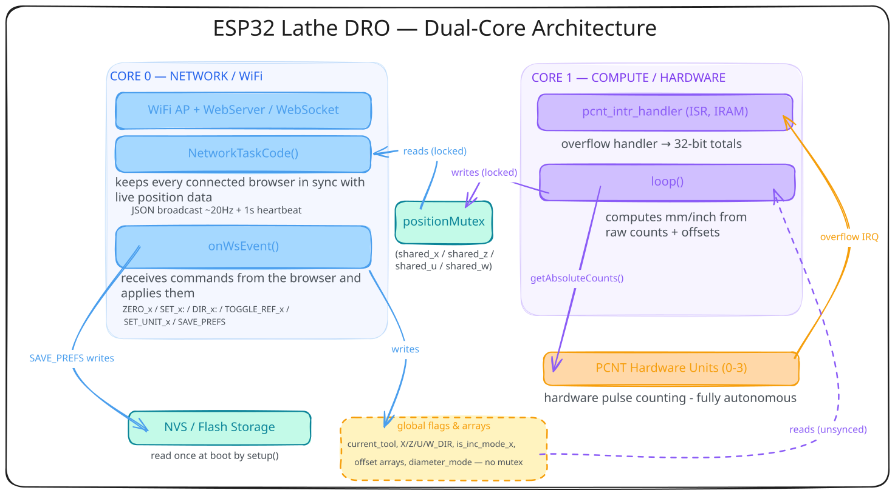

- **Warum ein ESP32?** Ein 5-µm-Maßstab liefert 200 Zählschritte pro mm – bei 50 mm/s sind das
  10.000 Schritte pro Sekunde und Achse. Ein Arduino Uno hat nur zwei Interrupt-Pins (gebraucht
  würden acht) und kein WLAN; ein ESP8266 hat einen Kern und keinen Hardware-Zähler. Der ESP32 hat
  **Hardware-Pulszähler (PCNT)** und **zwei Kerne**.
- **Kern 1** rechnet: Er liest die Zähler, verrechnet Werkzeugversätze, Durchmesser usw. und schreibt
  die Positionen in einen gemeinsamen Speicher, geschützt durch einen Mutex.
- **Kern 0** betreibt WLAN-Zugangspunkt, Webserver und den WebSocket, der die Positionen an den
  Browser schickt (höchstens 20-mal pro Sekunde, nur bei Änderung, dazu jede Sekunde ein
  Lebenszeichen für die Verbindungsanzeige).
- Die PCNT-Zähler sind 16 Bit breit. Bei ±30.000 Schritten (= 150 mm bei 5 µm) verschiebt ein
  hoch priorisierter Interrupt den Stand in eine 32-Bit-Summe – der Weg ist praktisch unbegrenzt.
- Ein Hardware-Filter verwirft Störimpulse kürzer als 1,25 µs.
- Auflösung, Richtung, Einheit und Achsanzahl liegen im NVS-Flash.

Die Diagramm-Quelle lässt sich auf [excalidraw.com](https://excalidraw.com) öffnen und bearbeiten
([`docs/diagram/ESP32_Dual_Core_Diagramm.excalidraw`](docs/diagram/ESP32_Dual_Core_Diagramm.excalidraw)).

---

## Firmware selbst kompilieren

**Genau diese Versionen** verwenden – die Arduino IDE (2.x) reicht:

| Komponente | Version |
|---|---|
| Boardpaket **esp32 by Espressif Systems** | **2.0.14** – **nicht** 3.x: Dort fehlt der hier genutzte alte PCNT-Treiber, und AsyncTCP läuft instabil |
| [AsyncTCP](https://github.com/dvarrel/AsyncTCP) | 1.1.4 |
| [ESPAsyncWebServer](https://github.com/lacamera/ESPAsyncWebServer) | 3.1.0 |

Board: **ESP32 Dev Module**, Flash 4 MB, Partitionsschema „Default 4MB with spiffs“.
[`firmware/ESP32_Lathe_DRO/ESP32_Lathe_DRO.ino`](firmware/ESP32_Lathe_DRO/ESP32_Lathe_DRO.ino) öffnen,
kompilieren und hochladen. Der Kopf der `.ino` enthält die vollständige technische Beschreibung (englisch).

---

## Test auf Schrittverluste

Achse gegen einen festen Anschlag oder ein Endmaß fahren und nullen. Dann die Achse schnell mehr als
200 mm wegkurbeln (dabei läuft der Zähler bei 150 mm über) und zurück an denselben Anschlag. Die
Anzeige muss wieder 0,00 zeigen.

---

## Lizenz und Haftungsausschluss

- Firmware (`firmware/`): [MIT-Lizenz](LICENSE)
- Hardware, Gehäuse, Diagramm und Bilder (`hardware/`, `case/`, `docs/`, `images/`):
  [CC BY-SA 4.0](LICENSE-hardware)

Dieses Projekt wird ohne jede Gewähr bereitgestellt. Der Autor haftet nicht für Schäden,
Fehlfunktionen oder andere Folgen der Nutzung. Es ist für Hobby- und Versuchszwecke an
Werkzeugmaschinen gedacht – halte die üblichen Sicherheitsregeln ein und prüfe Verdrahtung,
Signalpegel und Maschinenbetrieb jederzeit selbst.

Von **Anton CNC** – [YouTube](https://www.youtube.com/@boessi)
