# ESP32 Lathe DRO – Digital Readout for up to 4 Axes

**English** | [Deutsch](README.de.md)

A digital readout (DRO) for the lathe, built around an **ESP32 DevKit V1**. It reads up to four
linear scales (glass scales or magnetic tape) and shows the positions on **any touch device** –
phone or tablet – through a web page served by the ESP32's own Wi-Fi access point. No app, no
internet connection, no display hardware needed.

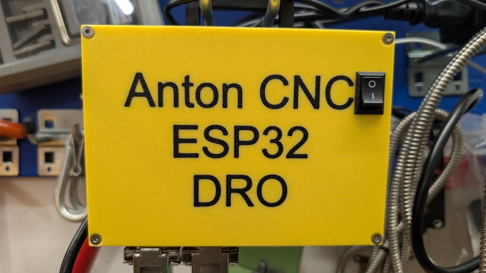

🎥 **Video (German):** *link follows when the video is published*

🛠️ **Building and printing the case (German):** [https://www.youtube.com/watch?v=JSoUT4cyio0](https://www.youtube.com/watch?v=JSoUT4cyio0)

📺 Channel: [Anton CNC on YouTube](https://www.youtube.com/@boessi)

Firmware version: **v1.0**

---

## Contents

- [Features](#features)
- [What's in this repository](#whats-in-this-repository)
- [Hardware](#hardware)
- [Wiring](#wiring)
- [Flashing the firmware (no Arduino IDE needed)](#flashing-the-firmware-no-arduino-ide-needed)
- [First start](#first-start)
- [Operation](#operation)
- [How it works](#how-it-works)
- [Building the firmware yourself](#building-the-firmware-yourself)
- [Testing for lost steps](#testing-for-lost-steps)
- [License and disclaimer](#license-and-disclaimer)

---

## Features

- **2, 3 or 4 axes** (X, Z, U, W), selectable in the settings
- **Hardware counting:** the ESP32's pulse counter (PCNT) decodes the A/B quadrature signals in
  silicon, 4× evaluation of every edge – no lost steps from busy software, 0 % CPU load for counting
- Default **200 pulses/mm (5 µm scales)**, presets for 1 µm, any custom value per axis
- **10 tools (T1–T10)** with their own offsets; T1 is the master/reference tool
- **ABS / INC per axis** – e.g. Z in chain-dimension mode while X stays absolute
- **Radius / diameter** mode for the cross slide
- **Compound slide helper** for taper and thread turning (angle → ΔX / ΔZ)
- **mm or inch** display
- **SAVE** stores offsets, active tool and scale positions permanently (NVS flash)
- **Connection indicator:** green/red dot, "CONNECTION LOST" banner, warning tone
- Responsive web UI for phones (portrait) and iPads; can be installed as a home-screen app

> The long-press buttons (SAVE, settings gear, 2X/3X/4X, axis direction) are made for touch
> screens. Use a phone or tablet – a mouse cannot do the long press.

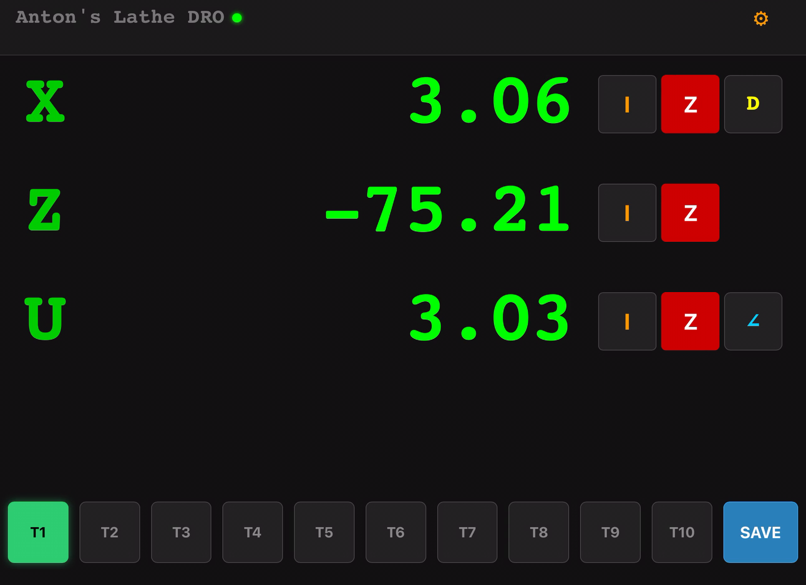

*Main display: iPad in landscape. Below: the same interface on a phone.*

<p align="center">
  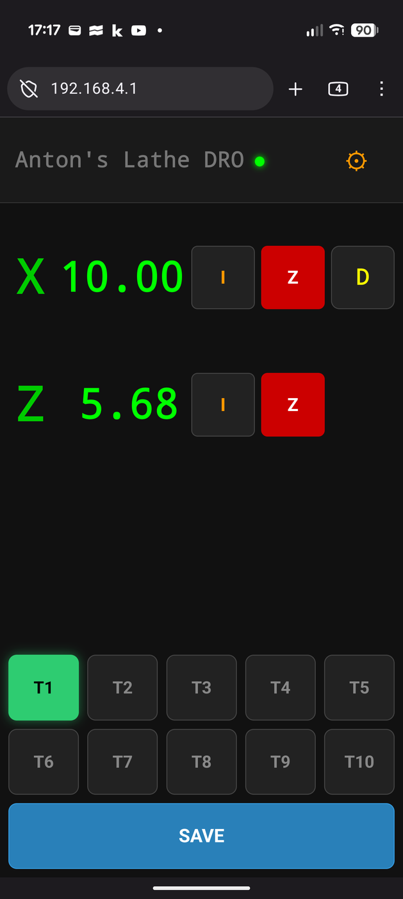
  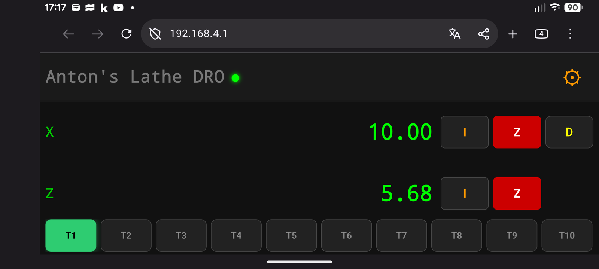
</p>


---

## What's in this repository

| Folder | Content |
|---|---|
| [`firmware/ESP32_Lathe_DRO/`](firmware/ESP32_Lathe_DRO/) | Arduino source code (`.ino`) |
| [`firmware/bin/`](firmware/bin/) | Ready-to-flash binaries (see [Flashing](#flashing-the-firmware-no-arduino-ide-needed)) |
| [`hardware/kicad/`](hardware/kicad/) | **Recommended PCB** – KiCad 10 project and [schematic as PDF](hardware/kicad/DRO_schematic.pdf) |
| [`hardware/kicad/fabrication/`](hardware/kicad/fabrication/) | Gerber, BOM and pick-and-place files for JLCPCB, [ordering notes](hardware/kicad/fabrication/ORDERING.md) |
| [`hardware/fusion-legacy/`](hardware/fusion-legacy/) | First PCB version from Fusion – **without pull-up resistors and without the on/off switch terminal**, see its [README](hardware/fusion-legacy/README.md) |
| [`case/`](case/) | Case: Fusion design [`DRO_Gehaeuse.f3d`](case/DRO_Gehaeuse.f3d) (housing, lid, aluminium plate, PCB model, CAM setup) and 3D-print files (STL and 3MF) |
| [`docs/diagram/`](docs/diagram/) | System diagram (Excalidraw source and SVG) |
| [`images/`](images/) | Photos and renderings |

---

## Hardware

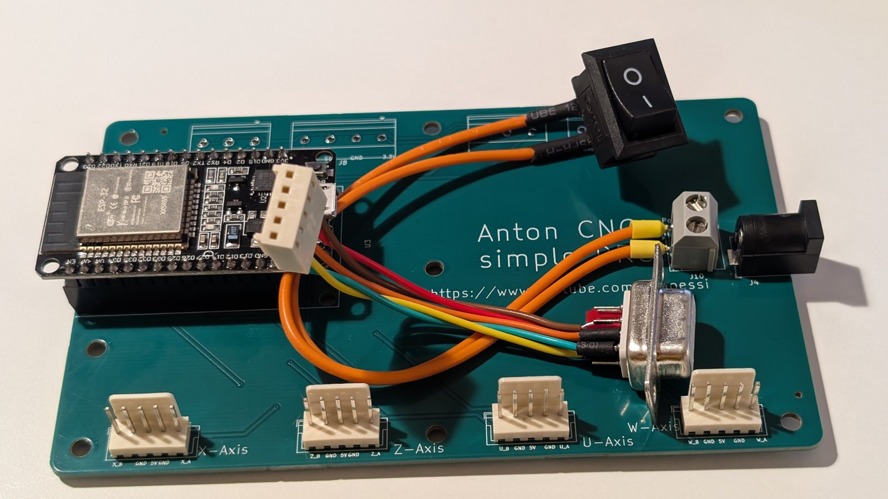

### Parts

- **PCB** from [`hardware/kicad/`](hardware/kicad/), 130 × 80 mm, 2 layers. JLCPCB can assemble the
  SMD parts on the bottom side (U1, U2, R1–R8, C1, C2); everything else is through-hole and easy to
  solder by hand. Details and part numbers: [ORDERING.md](hardware/kicad/fabrication/ORDERING.md).
- **ESP32 DevKit V1, 30 pins** (ESP32-WROOM-32). The antenna points outward over the board edge.
- **Linear scales** with 5 V TTL quadrature output (A/B), e.g. glass scales or magnetic tape
  readers, up to four.
- **5 V power supply** with barrel plug (≥ 2 A recommended) and an **on/off switch** for the case.
- **Sub-D 9 (DB9) panel connectors** for the scales, cables to the JST-XH sockets on the PCB.
- **Case:** [`case/Gehaeuse.stl`](case/Gehaeuse.stl) and [`case/Deckel.stl`](case/Deckel.stl)
  (also as 3MF); the editable Fusion design is [`case/DRO_Gehaeuse.f3d`](case/DRO_Gehaeuse.f3d).
  How the case is built and printed: [video](https://www.youtube.com/watch?v=JSoUT4cyio0).

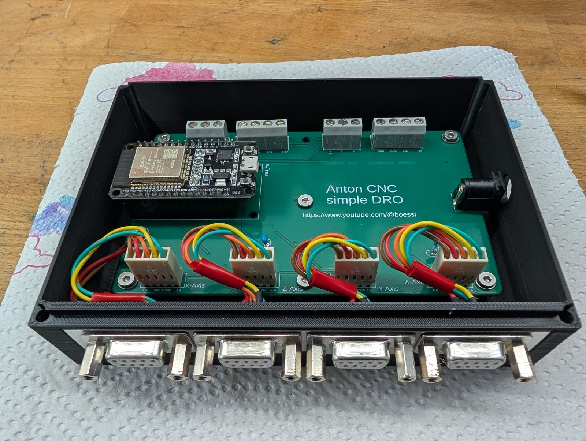

### The PCB in short

- **J1 / J2 / J3 / J5** (JST-XH, 5 pins): scale inputs X / Z / U / W
- **R1–R8** (10 kΩ to +5 V): pull-ups on every A/B line, so an unplugged input does not float
  and produce phantom counts
- **U1, U2** (SN74LVC14A): Schmitt-trigger inverters at 3.3 V with 5 V tolerant inputs – they turn
  slow, noisy edges into clean square waves and shift 5 V down to 3.3 V for the ESP32. The
  inversion does no harm because both tracks are inverted alike.
- **J4** barrel jack 5 V → **J10** on/off switch → +5 V → ESP32 VIN
- **J6–J9** screw terminals: spare GPIOs, +5 V, +3.3 V and GND for future extensions

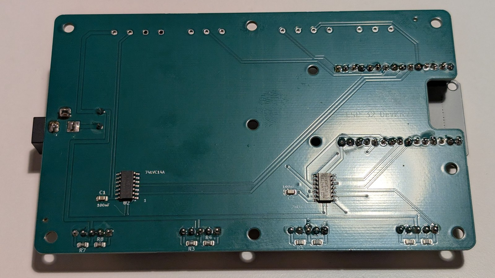

<p align="center">
  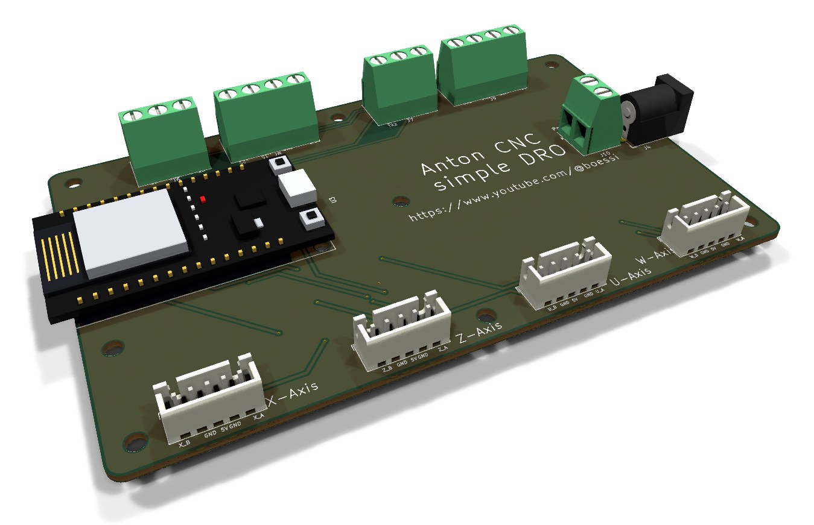
  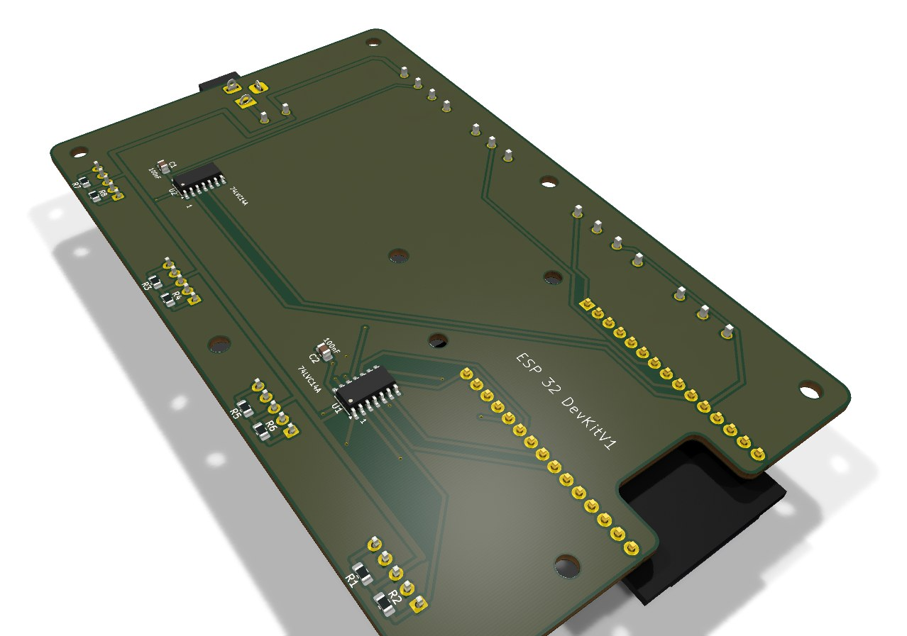
</p>

[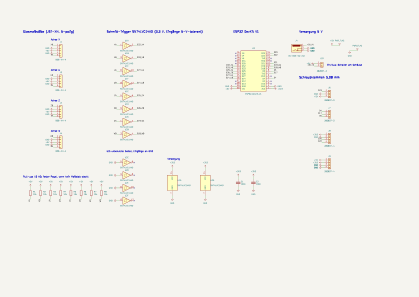](hardware/kicad/DRO_schematic.pdf)

*Schematic – click for the PDF.*

---

## Wiring

### Scale → Sub-D 9 (as wired in the case)

| Sub-D pin | Signal |
|---|---|
| 2 | GND |
| 4 | GND (shield) |
| 6 | Channel A |
| 7 | +5 V supply for the scale |
| 8 | Channel B |

Pinouts of scales differ between manufacturers – **always check your scale's datasheet** and
measure before connecting. Swapping A and B only inverts the counting direction (which can also be
changed in the settings).

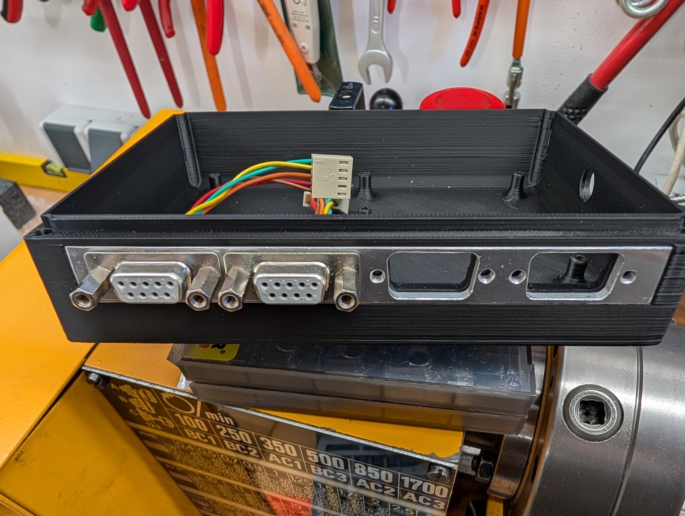

### Sub-D → JST-XH on the PCB

| JST pin | 1 | 2 | 3 | 4 | 5 |
|---|---|---|---|---|---|
| Signal | B | GND | +5 V | GND | A |

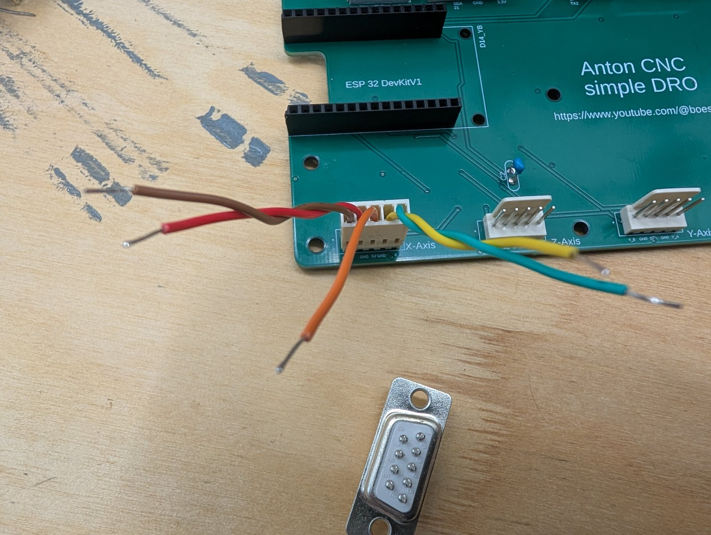

### Axes → ESP32 inputs

| Axis | Socket | Channel A | Channel B |
|---|---|---|---|
| X | J1 | GPIO 32 | GPIO 33 |
| Z | J2 | GPIO 25 | GPIO 26 |
| U | J3 | GPIO 27 | GPIO 14 |
| W | J5 | GPIO 19 | GPIO 18 |

### Spare terminals

| Terminal | Pins |
|---|---|
| J6 | GPIO 23, GND, +5 V |
| J7 | GPIO 4, GPIO 17, GPIO 5 |
| J8 | +3.3 V, GND, GPIO 21, GPIO 22 |
| J9 | +5 V, +3.3 V, GND, GND |
| J10 | on/off switch (between barrel jack and +5 V) |

---

## Flashing the firmware (no Arduino IDE needed)

You need a Windows PC, a USB cable (data, not charge-only) and the ESP32 DevKit.

### 1. Download the tools

- **Flash Download Tool** from Espressif:
  [espressif.com → Support → Download → Other Tools → "Flash Download Tools"](https://www.espressif.com/en/support/download/other-tools)
  ([user guide](https://docs.espressif.com/projects/esp-test-tools/en/latest/esp32/production_stage/tools/flash_download_tool.html)).
  Unzip it and start `flash_download_tool_*.exe` – no installation needed.
- **USB driver**, if Windows shows no COM port for the board. Look at the small chip next to the
  USB socket:
  - CP2102 / CP210x → [Silicon Labs CP210x VCP driver](https://www.silabs.com/developer-tools/usb-to-uart-bridge-vcp-drivers)
  - CH340 → [WCH CH341SER driver](https://www.wch.cn/downloads/CH341SER_EXE.html)
- **The firmware:** [`firmware/bin/ESP32_Lathe_DRO_v1.0_merged.bin`](firmware/bin/ESP32_Lathe_DRO_v1.0_merged.bin)
  (on GitHub: open the file, then "Download raw file").

### 2. Flash

1. **Disconnect the 5 V power supply** of the DRO and connect the ESP32 to the PC by USB.
   In the Device Manager, note the COM port (e.g. COM3).
2. Start the Flash Download Tool. In the first dialog choose
   **ChipType: ESP32, WorkMode: Develop, LoadMode: UART** → OK.
3. Set everything as in the picture below:
   1. First line of the **SPIDownload** tab: tick the box, select
      `ESP32_Lathe_DRO_v1.0_merged.bin` with "…" and enter the address **`0x0`**.
      All other lines stay unticked.
   2. **SPI SPEED: 40MHz, SPI MODE: DIO**, leave "DoNotChgBin" ticked.
   3. Select the **COM port**, **BAUD: 921600** (if it fails: 115200).
   4. For the very first flash, click **ERASE** once and wait for "FINISH". This clears the whole
      flash, including previously saved settings.
   5. Click **START** and wait until the panel shows **"FINISH"**.
4. Press **EN** on the ESP32 (or unplug and replug USB) to restart it. Done.

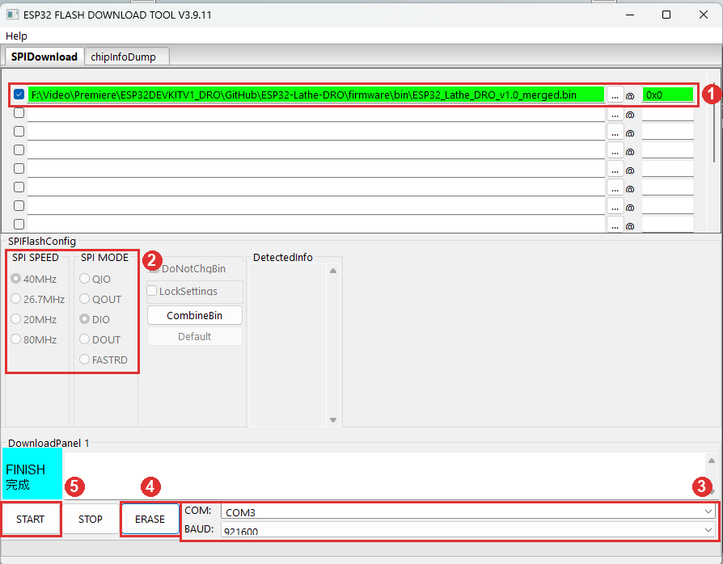

<details>
<summary>Alternative: four single files instead of the merged file</summary>

| File | Address |
|---|---|
| `bootloader.bin` | `0x1000` |
| `partitions.bin` | `0x8000` |
| `boot_app0.bin` | `0xe000` |
| `ESP32_Lathe_DRO_v1.0_app.bin` | `0x10000` |

</details>

<details>
<summary>Alternative for Linux / macOS: esptool</summary>

```
pip install esptool
esptool.py --chip esp32 --port /dev/ttyUSB0 write_flash 0x0 ESP32_Lathe_DRO_v1.0_merged.bin
```

</details>

---

## First start

1. Switch the DRO on and connect your phone or tablet to the Wi-Fi network
   **`AntonCNC_ESP32-DRO`**, password **`12345678`**.
   It is a good idea to change the password: it is set in the source code (`password` near the
   top of the `.ino`), so this requires building the firmware yourself.
2. Open **http://192.168.4.1** in Chrome (Android) or Safari (iPad). Portrait orientation works
   best on phones.
3. Install it as an app: browser menu → **"Add to Home screen" / "Install app"**. Then start the
   DRO from the new icon – it opens full-screen without browser bars.
4. Keep the screen awake: set the display timeout to the maximum (or Android developer options →
   "Stay awake" while charging). Optional: Android "App pinning" or iPadOS "Guided Access".
5. Open the settings (**press and hold the gear ⚙ for 0.8 s**) and set
   the number of axes, the counting direction of each axis and the scale resolution.

---

## Operation

| Action | How |
|---|---|
| Select tool | Tap **T1 … T10** in the bottom bar. T1 is the reference tool: in ABS mode all other tools are stored relative to T1 – touch off T1 again after a reboot. |
| Zero an axis | Red **Z** next to the axis → confirm with **YES** (only for the active tool) |
| Enter a value | Orange **I** → numpad (with +/-) → **SET** |
| ABS / INC | Tap the **axis letter**: green = ABS, yellow = INC, per axis |
| Radius / diameter | **R / D** on the X row – D shows the diameter (×2) |
| Compound slide helper | **∠** on the U row – angle, raw U, resulting ΔX/ΔZ and combined X/Z. Not saved (resets on reload). |
| Save | Press and hold **SAVE** for about 1 s until the tone – stores offsets, active tool, ABS/INC state and the scale positions |
| Settings | Press and hold **⚙** for 0.8 s: mm/inch, number of axes (hold 1 s), axis direction (hold 0.8 s), scale resolution (5 µm / 1 µm / custom, **SAVE RESOLUTIONS**) |
| Connection lost | Red dot and banner "CONNECTION LOST" → tap the banner to reload. There is intentionally no silent auto-reconnect. |

---

## How it works

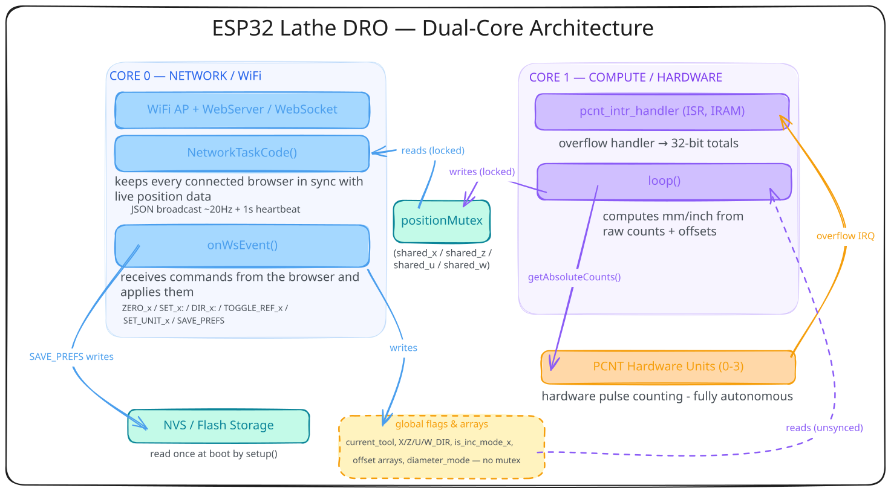

- **Why an ESP32?** A 5 µm scale gives 200 counts per mm – at 50 mm/s that is 10,000 counts per
  second per axis. An Arduino Uno has only two interrupt pins (eight would be needed) and no Wi-Fi;
  an ESP8266 has one core and no hardware counter. The ESP32 has **hardware pulse counters (PCNT)**
  and **two cores**.
- **Core 1** runs the math: it reads the counters, applies tool offsets, diameter mode etc. and
  writes the positions into shared memory, protected by a mutex.
- **Core 0** runs the Wi-Fi access point, the web server and the WebSocket that sends the positions
  to the browser (max. 20 Hz, only on change, plus a heartbeat every second for the connection
  indicator).
- The PCNT counters are 16 bit. At ±30,000 counts (= 150 mm at 5 µm) a high-priority interrupt
  moves the count into a 32-bit total – the range is practically unlimited.
- A hardware glitch filter ignores pulses shorter than 1.25 µs.
- Scale resolution, direction, unit and number of axes are stored in NVS flash.

The diagram source can be opened and edited on [excalidraw.com](https://excalidraw.com)
([`docs/diagram/ESP32_Dual_Core_Diagramm.excalidraw`](docs/diagram/ESP32_Dual_Core_Diagramm.excalidraw)).

---

## Building the firmware yourself

Use **exactly these versions** – the Arduino IDE (2.x) is fine:

| Component | Version |
|---|---|
| Board package **esp32 by Espressif Systems** | **2.0.14** – do **not** use 3.x: it removes the legacy PCNT driver used here and makes AsyncTCP unstable |
| [AsyncTCP](https://github.com/dvarrel/AsyncTCP) | 1.1.4 |
| [ESPAsyncWebServer](https://github.com/lacamera/ESPAsyncWebServer) | 3.1.0 |

Board: **ESP32 Dev Module**, flash 4 MB, partition scheme "Default 4MB with spiffs".
Open [`firmware/ESP32_Lathe_DRO/ESP32_Lathe_DRO.ino`](firmware/ESP32_Lathe_DRO/ESP32_Lathe_DRO.ino),
compile and upload. The header of the `.ino` contains the full technical documentation.

---

## Testing for lost steps

Move the axis against a fixed stop or gauge block and zero it. Then crank the axis quickly more
than 200 mm away (this triggers a counter overflow at 150 mm) and back to the same stop. The
display must show 0.00 again.

---

## License and disclaimer

- Firmware (`firmware/`): [MIT License](LICENSE)
- Hardware, case, diagram and images (`hardware/`, `case/`, `docs/`, `images/`):
  [CC BY-SA 4.0](LICENSE-hardware)

This project is provided "as is", without any warranty. The author is not liable for any damage,
malfunction or other consequences of its use. It is meant for hobby and experimental use on machine
tools – observe proper safety precautions, and verify wiring, signal levels and machine operation
yourself at all times.

Made by **Anton CNC** – [YouTube](https://www.youtube.com/@boessi)
